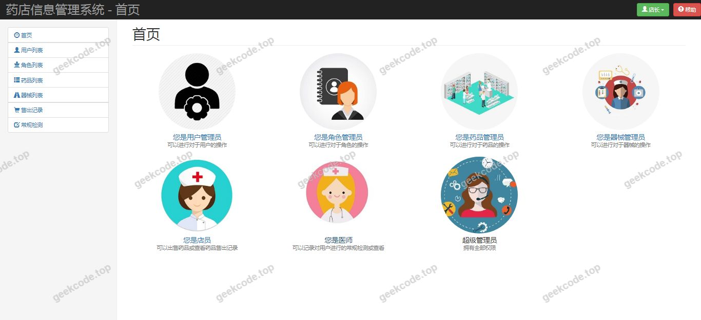
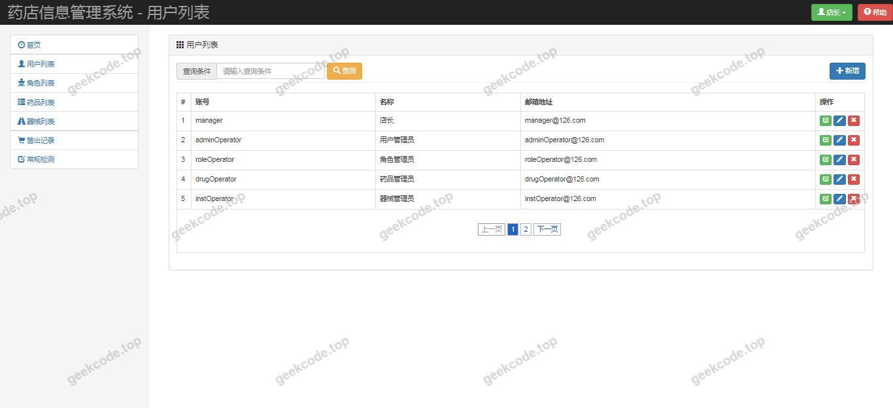
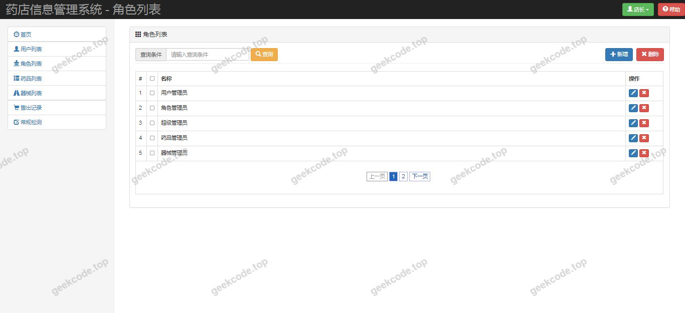
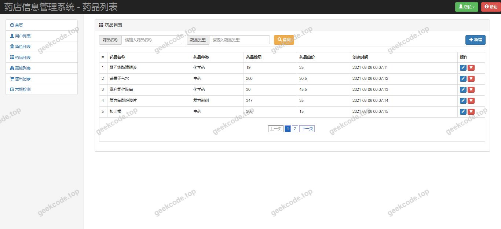
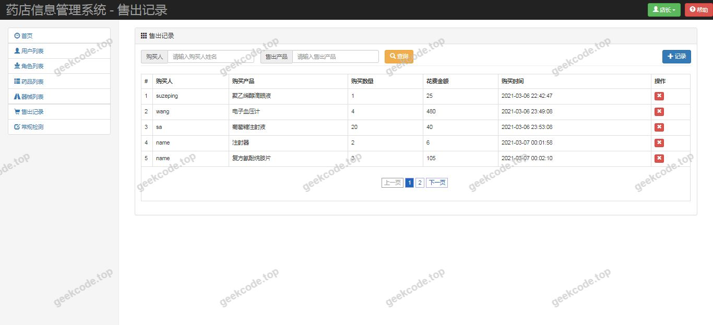
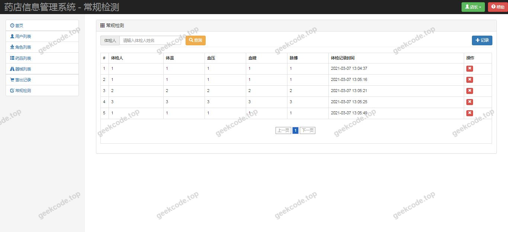
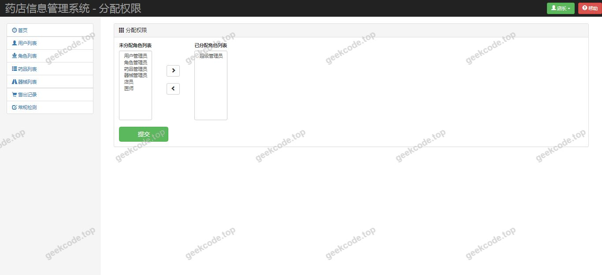

# java精品项目-基于ssm的药店信息管理系统

> 🎓 **计算机毕业设计 · java精品项目-基于ssm的药店信息管理系统**
>
> 本仓库只放**项目介绍 + 运行截图**（截图是站点带水印的原图，存在仓库 `images/` 里）。
>
> 👉 **完整可运行源码 / 数据库脚本 / 部署文档：[点我获取](https://geekcode.top/archives/java%E7%B2%BE%E5%93%81%E9%A1%B9%E7%9B%AE-%E5%9F%BA%E4%BA%8Essm%E7%9A%84%E8%8D%AF%E5%BA%97%E4%BF%A1%E6%81%AF%E7%AE%A1%E7%90%86%E7%B3%BB%E7%BB%9F?utm_source=github)**
>
> 💬 咨询微信：**ir9372**　|　🌐 更多项目：[极客代码 geekcode.top](https://geekcode.top/?utm_source=github)
>
> 📌 项目详情页：<https://geekcode.top/archives/java%E7%B2%BE%E5%93%81%E9%A1%B9%E7%9B%AE-%E5%9F%BA%E4%BA%8Essm%E7%9A%84%E8%8D%AF%E5%BA%97%E4%BF%A1%E6%81%AF%E7%AE%A1%E7%90%86%E7%B3%BB%E7%BB%9F?utm_source=github>

<table><td width="230" align="center"> <b>扫码加微信 ir9372</b></td><td valign="middle">📦 源码 = 项目介绍 + 全部运行截图 + 数据库 + 部署文档 👉 点上方任意截图，直接跳到 <b>极客代码 geekcode.top</b> 详情页</td></table>

---

<h1>java精品项目-基于ssm的药店信息管理系统</h1>
<h2>项目概述</h2>

本项目为“基于 SSM 的药店信息管理系统”，旨在通过信息化手段解决传统药店在药品库存、销售记录及基础信息管理上的效率低下问题。系统采用经典的 SSM（Spring + Spring MVC + MyBatis）架构，结合 JSP 前端技术构建 Web 应用。核心功能涵盖药店基础数据的维护与管理，适用于中小型药店的日常运营场景。系统后端基于 Java 语言开发，利用 MyBatis-Plus 简化数据持久层操作，Druid 提供数据库连接池监控，PageHelper 实现高效分页处理。虽然项目标记为无独立的前台用户端和后台管理端路由划分，但根据截图显示的“系统运行界面”及 SSM 典型架构推断，该系统主要面向药店内部管理人员使用，通过统一的 Web 界面进行业务操作，实现了从药品入库到信息查询的全流程数字化管理，提升了药店管理的规范性与便捷性。

<h2>技术架构</h2>

本项目采用分层架构设计，严格遵循 MVC 设计模式，确保代码的高内聚低耦合。

<strong>1. 表现层 (Presentation Layer)</strong>
使用 JSP 技术作为视图渲染引擎，负责前端页面的展示与用户交互。通过 HTML/CSS/JavaScript 构建用户界面，接收用户请求并展示处理结果。

<strong>2. 控制层 (Controller Layer)</strong>
基于 Spring MVC 框架构建。<code>spring-webmvc</code> 负责拦截 HTTP 请求，解析参数，调用业务逻辑，并将模型数据返回给视图层。控制器类通常以 <code>@Controller</code> 或 <code>@RestController</code> 注解标识，处理具体的业务入口。

<strong>3. 业务逻辑层 (Service Layer)</strong>
由 Spring 框架核心容器管理 Bean 的生命周期。<code>spring-orm</code> 模块整合了 ORM 映射，支持事务管理。业务逻辑在此层实现，包括数据校验、业务规则处理等。

<strong>4. 数据访问层 (DAO/Mapper Layer)</strong>
采用 MyBatis-Plus 作为持久层框架。MyBatis-Plus 在 MyBatis 基础上进行了增强，提供了通用的 CRUD 接口，大幅减少了样板代码。同时集成 PageHelper 插件，用于处理复杂的分页查询需求，提升大数据量下的查询性能。

<strong>5. 基础设施与中间件</strong>

<ul>
<li><strong>数据库连接池</strong>: 使用 Druid 作为数据库连接池。Druid 不仅性能优异，还提供了强大的监控功能，可实时查看 SQL 执行状态、连接池使用情况等，便于系统运维和问题排查。</li>
<li><strong>AOP 切面编程</strong>: 引入 <code>aspectjweaver</code>，用于实现日志记录、权限校验等非业务功能的横切关注点分离。</li>
<li><strong>动态代理</strong>: 依赖 <code>cglib</code> 实现类的动态代理，支持 Spring AOP 的功能实现。</li>
</ul>

<strong>6. 数据存储</strong>
底层数据库采用 MySQL，通过 <code>mysql-connector-java</code> 驱动进行连接。数据库设计围绕药店核心实体（如药品、供应商、销售订单等）展开，确保数据的一致性与完整性。

<h2>功能模块</h2>

根据提供的截图列表（系统运行界面1-8）及技术栈特征，本系统主要包含以下核心功能模块。由于项目未明确区分前台与后台路由，且标注“是否有前台: 否”、“是否有后台: 否”，以下功能模块描述基于通用 SSM 药店管理系统的标准业务逻辑及可见的运行界面推导：

<strong>1. 药品信息管理模块</strong>

<ul>
<li><strong>药品录入</strong>: 支持新增药品基本信息，包括名称、规格、单位、价格、生产厂家等。</li>
<li><strong>药品修改</strong>: 对已存在的药品信息进行更新维护。</li>
<li><strong>药品删除</strong>: 移除不再销售的药品记录。</li>
<li><strong>药品查询</strong>: 支持按名称、分类等多条件模糊搜索，快速定位药品。</li>
</ul>

<strong>2. 库存管理模块</strong>

<ul>
<li><strong>入库管理</strong>: 记录药品采购入库信息，自动增加库存数量。</li>
<li><strong>出库管理</strong>: 记录药品销售或调拨出库信息，自动扣减库存数量。</li>
<li><strong>库存盘点</strong>: 查看当前所有药品的剩余库存，支持预警设置（如低库存提醒）。</li>
</ul>

<strong>3. 销售管理模块</strong>

<ul>
<li><strong>销售开单</strong>: 模拟收银台操作，选择药品生成销售订单。</li>
<li><strong>订单查询</strong>: 查看历史销售记录，支持按时间、金额筛选。</li>
<li><strong>销售统计</strong>: 汇总特定时间段内的销售总额、热销药品排行等数据。</li>
</ul>

<strong>4. 基础数据维护模块</strong>

<ul>
<li><strong>供应商管理</strong>: 维护药品供应商的基本信息，如名称、联系方式、地址。</li>
<li><strong>用户/管理员管理</strong>: 系统登录用户的账号创建、密码重置及角色分配（若存在多角色）。</li>
</ul>

<strong>5. 系统辅助功能</strong>

<ul>
<li><strong>分页浏览</strong>: 基于 PageHelper，在所有列表页面提供分页导航，优化用户体验。</li>
<li><strong>数据导出/打印</strong>: 部分报表界面可能支持将查询结果导出或打印小票（依据常见药店系统功能推测，具体需视截图细节而定，此处仅列出通用必要功能）。</li>
</ul>
<h2>用户角色与权限</h2>

根据项目描述中“是否有前台: 否”和“是否有后台: 否”的特殊标记，以及 SSM 单体应用的常见部署形态，本系统极可能采用<strong>单一管理员角色</strong>或<strong>隐式统一权限体系</strong>。在没有明确的多角色定义文档情况下，基于药店管理系统的实际应用场景，权限设计如下：

<strong>1. 系统管理员 (Administrator)</strong>
这是系统中唯一明确的角色类型，拥有最高权限，负责所有业务数据的维护和管理。

<ul>
<li><strong>可访问模块</strong>:</li>
<li><strong>全部药品信息</strong>: 增删改查。</li>
<li><strong>全部库存记录</strong>: 入库、出库、盘点。</li>
<li><strong>全部销售订单</strong>: 创建、查询、统计。</li>
<li><strong>基础数据</strong>: 供应商信息维护、用户账户管理。</li>
<li><strong>系统配置</strong>: 如有日志查看或数据备份功能，亦在此权限范围内。</li>
</ul>

<strong>2. 普通操作员 (Operator) [可选/隐含]</strong>
<em>注：由于源码上下文未提及 RBAC（基于角色的访问控制）具体表结构或注解，若系统仅服务于小型药店店主一人，则此角色不存在；若支持店员协作，则可能存在此受限角色。</em>

<ul>
<li><strong>可访问模块</strong>:</li>
<li><strong>药品查询</strong>: 仅读取权限。</li>
<li><strong>销售开单</strong>: 仅限创建新订单，不可删除历史记录。</li>
<li><strong>个人业绩查看</strong>: 仅能查看自己经手的销售记录。</li>
</ul>

<strong>权限控制机制</strong>:
系统通过 Spring MVC 拦截器 (Interceptor) 或 AOP 切面 (<code>aspectjweaver</code>) 实现权限校验。用户登录后，Session 中存储用户身份标识。每次请求到达 Controller 前，拦截器检查 Session 有效性及用户角色对应的 URL 访问权限。对于写操作（POST/PUT/DELETE），严格限制为管理员角色。

<h2>项目特色与创新点</h2>

<strong>1. 高效的数据持久化方案</strong>
摒弃传统的原生 JDBC 或基础 MyBatis 手写 SQL 方式，采用 <strong>MyBatis-Plus</strong> 框架。通过继承 <code>BaseMapper</code> 接口，无需编写 XML 即可实现绝大多数单表 CRUD 操作，显著降低了开发工作量，提高了代码的可读性和维护性。

<strong>2. 企业级的数据库连接监控</strong>
集成 <strong>Druid</strong> 连接池而非默认的 HikariCP 或 DBCP。Druid 提供了内置的监控页面（StatViewServlet），开发者可以实时监控 SQL 执行耗时、慢 SQL 记录、连接池活跃数等关键指标。这对于药店这种对数据准确性要求高、并发量适中的场景，提供了强有力的运维保障能力，能快速定位性能瓶颈。

<strong>3. 优雅的分页处理体验</strong>
引入 <strong>PageHelper</strong> 插件，实现了物理分页与逻辑分页的无缝切换。在复杂查询场景下，只需一行代码即可实现分页，避免了手动计算 offset 和 limit 的错误风险，确保了在大数量级药品库和销售记录下的页面加载速度。

<strong>4. 轻量级且稳定的架构选型</strong>
采用成熟的 SSM (Spring + SpringMVC + MyBatis) 组合，配合 JSP 前端。虽然并非最新微服务架构，但对于毕业设计级别的单体应用而言，该架构稳定性极高，生态完善，易于调试和部署。相比前后端分离架构，JSP 在服务端渲染上具有 SEO 友好、首屏加载快、开发链路短的优势，非常适合内部管理系统。

<strong>5. 规范化的代码结构与扩展性</strong>
利用 <strong>AspectJ</strong> 和 <strong>CGLIB</strong> 实现面向切面编程。可以将日志记录、异常处理、事务管理等通用逻辑从业务代码中剥离，使得 Service 层代码更加纯净，专注于核心业务逻辑，符合软件工程的高内聚低耦合原则，便于后续功能扩展和维护。

<h2>部署环境</h2>

为确保“基于 SSM 的药店信息管理系统”正常运行，需准备以下软硬件环境：

<strong>1. 硬件环境</strong>

<ul>
<li><strong>CPU</strong>: Intel Core i3 及以上处理器。</li>
<li><strong>内存</strong>: 建议 4GB RAM 及以上（Java 应用及 MySQL 需要一定内存开销）。</li>
<li><strong>硬盘</strong>: 至少 10GB 可用空间，用于存放操作系统、软件安装包及数据库文件。</li>
</ul>

<strong>2. 软件环境</strong>

<ul>
<li><strong>操作系统</strong>: Windows 7/10/11, Linux (CentOS 7+, Ubuntu 18.04+), 或 macOS。</li>
<li><strong>JDK</strong>: Java Development Kit 1.8 (JDK 8)。SSM 经典版本通常基于 JDK 8 开发，兼容性最好。</li>
<li><strong>Web 服务器</strong>: Apache Tomcat 8.5 或 9.0。JSP 页面和 Servlet 容器依赖于 Tomcat 运行。</li>
<li><strong>数据库</strong>: MySQL Server 5.7 或 8.0。需安装 MySQL Connector/J 驱动（项目中已包含 <code>mysql-connector-java</code> 依赖）。</li>
<li><strong>开发工具 (IDE)</strong>: IntelliJ IDEA 或 Eclipse Enterprise Edition。用于代码编辑、编译和项目管理。</li>
<li><strong>构建工具</strong>: Maven 3.6+。用于管理项目依赖（pom.xml）和项目打包（WAR 包）。</li>
</ul>

<strong>3. 数据库初始化</strong>

<ul>
<li>需要在 MySQL 中创建对应的数据库实例（例如 <code>pharmacy_db</code>）。</li>
<li>导入项目提供的 SQL 脚本文件，以建立表结构（药品表、订单表、用户表等）并初始化基础测试数据。</li>
<li>配置 <code>jdbc.properties</code> 或 <code>applicationContext.xml</code> 中的数据库连接 URL、用户名和密码，确保指向本地 MySQL 服务。</li>
</ul>

<strong>4. 部署步骤简述</strong>

<ol>
<li>安装 JDK 并配置环境变量。</li>
<li>安装 MySQL 并启动服务，创建数据库并导入 SQL 脚本。</li>
<li>安装 Tomcat。</li>
<li>使用 Maven 命令 <code>mvn clean package</code> 打包项目生成 WAR 文件。</li>
<li>将 WAR 文件放入 Tomcat 的 <code>webapps</code> 目录。</li>
<li>启动 Tomcat，浏览器访问 <code>http://localhost:8080/[项目名]</code> 进入系统首页。</li>
</ol>
<h2>五、技术特性</h2>
<ul>
<li>服务端模板渲染（JSP）</li>
<li>使用 MyBatis-Plus 简化数据访问层开发</li>
</ul>
<h2>六、功能模块截图</h2>
<h3>前台用户端</h3>
<h4>系统运行界面1</h4>

<h4>系统运行界面2</h4>

<h4>系统运行界面3</h4>

<h4>系统运行界面4</h4>

<h4>系统运行界面5</h4>

<h4>系统运行界面6</h4>

<h4>系统运行界面7</h4>

<h4>系统运行界面8</h4>

---

## 获取完整源码

| 项目 | 说明 |
| --- | --- |
| 项目名 | java精品项目-基于ssm的药店信息管理系统 |
| 运行截图 | 本文 8 张（站点带水印原图，仓库 `images/` 目录） |
| 完整源码 | [https://geekcode.top/archives/java%E7%B2%BE%E5%93%81%E9%A1%B9%E7%9B%AE-%E5%9F%BA%E4%BA%8Essm%E7%9A%84%E8%8D%AF%E5%BA%97%E4%BF%A1%E6%81%AF%E7%AE%A1%E7%90%86%E7%B3%BB%E7%BB%9F?utm_source=github](https://geekcode.top/archives/java%E7%B2%BE%E5%93%81%E9%A1%B9%E7%9B%AE-%E5%9F%BA%E4%BA%8Essm%E7%9A%84%E8%8D%AF%E5%BA%97%E4%BF%A1%E6%81%AF%E7%AE%A1%E7%90%86%E7%B3%BB%E7%BB%9F?utm_source=github) |
| 咨询微信 | **ir9372**（备注：jingpin-yuanma） |
| 更多项目 | [极客代码 geekcode.top](https://geekcode.top/?utm_source=github) |

> 需要源码、部署、改配置、跑不起来等问题，加微信 ir9372 沟通，说明项目名即可。
